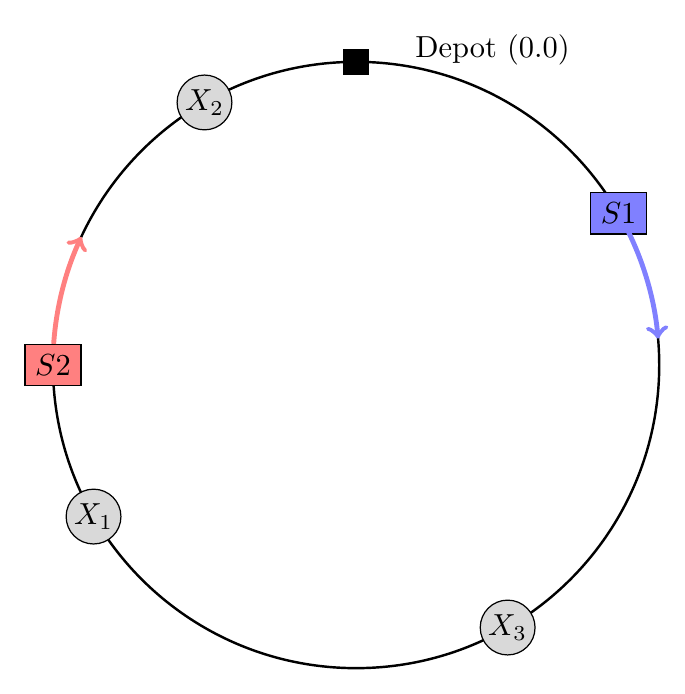
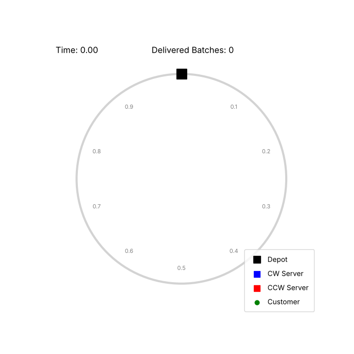

# Routing Policies in Multi-Server Continuous Polling Systems

Bachelor thesis on when server clustering hurts and when it helps. It combines exact results for limiting cases with a discrete-event simulation for heavy traffic.

**TU/e · Final Bachelor Project (2WH40) · Sep 2025 – Jan 2026 · Stochastic Operations Research group · Grade 8.5/10**

<!-- REPORT_LINK -->

<p align="center"></p>

## Problem

$c$ servers travel at constant speed around a circular route of circumference 1, with a depot at 0.0. Batches of customers arrive as a Poisson process with rate $\lambda$. Each batch has a random size $K$, and its customers get i.i.d. locations on the circle. An idle server serves the first waiting customer it meets (exhaustive discipline) and delivers everything it carries when it passes the depot. $c_1$ servers move clockwise and $c_2$ counter-clockwise, and the load per server is $\rho = \lambda\,\mathbb{E}[K]\,\mathbb{E}[B]/c$.

Performance is measured by the batch sojourn time $S^B$ (until the last customer of a batch is picked up) and the batch time to delivery $D^B$ (until it reaches the depot). These are compared against a clustering index $T$, the expected distance from a uniform point to the nearest server. Earlier work left open whether clustering is a symptom of instability or a useful way to pool capacity.

## Approach

- **Zero service time, $c = 2$.** Closed-form $\mathbb{E}[S^B]$ and $\mathbb{E}[D^B]$ for unidirectional and bidirectional routing, for a general batch-size distribution.
- **Light traffic, $\lambda \to 0$.** The limiting distribution of the distance between the two servers. It is uniform under bidirectional routing for any non-lattice service-time distribution, while unidirectional servers drift into clusters. The fixed-point integral equation is solved by discretisation and power iteration.
- **General traffic.** An object-oriented discrete-event simulation in Python, built on a future event set with arrival, service, end-of-service and delivery events and with depot-crossing detection. Each run lasts 10,000 delivered batches, and estimates average 1,000 independent replications with 95% $t$-intervals. The exact results fall inside the simulation's confidence intervals.
- **Experiments.** $c \in \{4, 6, 8, 10\}$ with loads $\rho$ from 0.1 to 0.9, service times $B \sim \text{Exp}(1)$ and batch sizes $K \sim \text{Geometric}(0.2)$.

## Key findings

- In light traffic, the balanced bidirectional policy ($c_2 = c/2$) wins on geometric efficiency. It cuts the expected time to delivery by up to 0.5–1.0% compared with unidirectional routing.
- In heavy traffic ($\rho \ge 0.5$), pure unidirectional routing dominates even though it clusters more. Trailing clusters act as one unit with the fleet's full service rate and clear large batches, while servers moving in opposite directions fragment capacity.
- The load at which unidirectional routing takes over rises by about $\Delta\rho \approx 0.1$ per step in server count, so larger fleets keep the bidirectional advantage for longer.
- Clustering is harmful when the system is travel-constrained and cooperative when it is service-constrained.

## Animation

<p align="center"> <br><em>Six servers at load ρ = 0.7 with Geometric(0.2) batch sizes, all moving clockwise (left) or alternating directions (right), from the same random seed.</em></p>

## Repository contents

- `src/Base/`: the discrete-event simulator. `Simulation.py` runs the event loop (arrivals, service, end of service and depot deliveries, with depot-crossing detection). `Server.py`, `Customer.py` and `Batch.py` hold the entities and their states, `FES.py` is the heap-based future event set, `SimResults.py` collects sojourn and delivery times, and `Clustering.py` records the clustering indices at every arrival.
- `src/stationary_density_power_iteration.py`: discretised power iteration for the light-traffic stationary density
- `src/animate_policies.py`: renders the two animations above. `src/animate_policies_with_delivery.py` does the same at half speed with a running mean time to delivery.

## Running one replication

```python
# save this file in src/ and run it from there
from scipy import stats
from Base.Simulation import Simulation

c, rho = 4, 0.6                      # servers and load per server
lam = rho * c / (5 * 1.0)            # E[K] = 5 for Geometric(0.2), E[B] = 1
sim = Simulation(stats.expon(scale=1 / lam), stats.geom(0.2), stats.uniform(0, 1), stats.expon(scale=1.0),
                 numServers=c, serverSpeed=1.0,
                 serverLocation=[0.0, 0.25, 0.5, 0.75],
                 serverRotation=[1, 1, 1, 1])        # -1 = counter-clockwise
sojourn, delivery, clustering = sim.simulate(10_000)  # stops after 10,000 delivered batches
print(sojourn.getMeanWaitingTime(), delivery.getMeanWaitingTime())
```

The full experiment sweeps and their results are in the thesis.

**Tools:** Python · NumPy · SciPy
